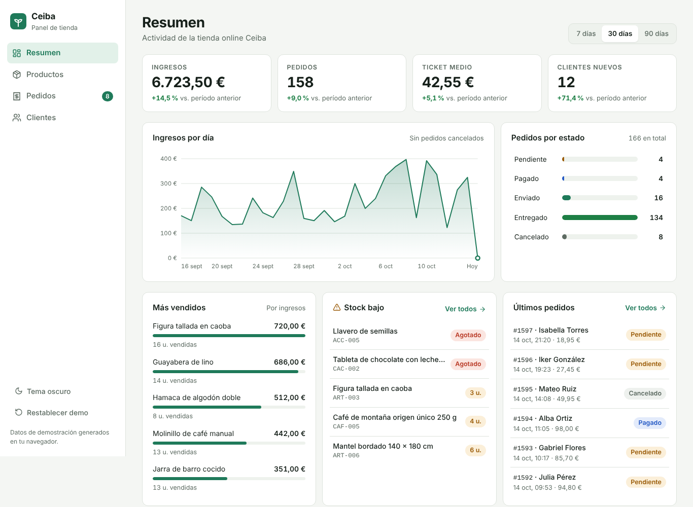
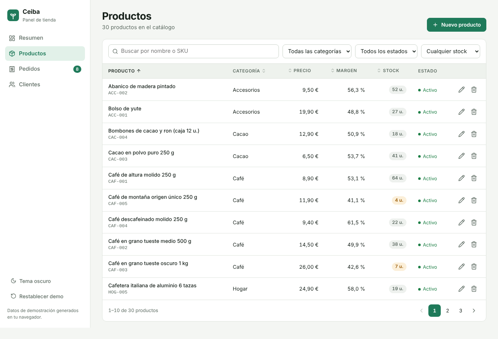
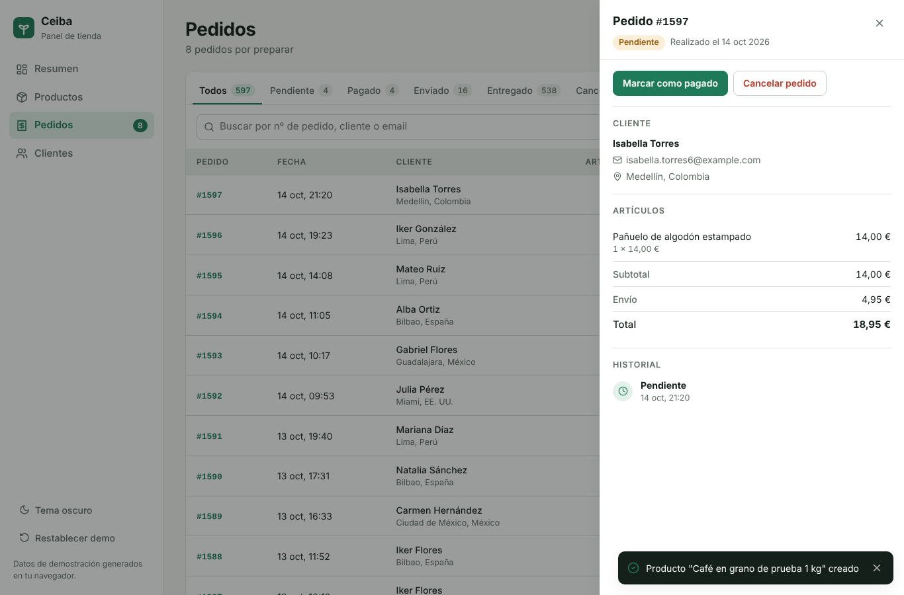
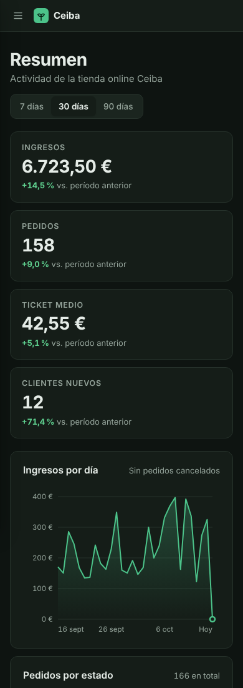

# Ceiba Admin

Panel de administración para una tienda online ficticia (café, cacao y artesanía), hecho con **React 19 + TypeScript + Vite**.

**Demo:** https://lachy97.github.io/ceiba-admin/



## Qué se puede hacer

- **Resumen**: ingresos, pedidos, ticket medio y clientes nuevos de los últimos 7, 30 o 90 días, comparados con el período anterior. Incluye un gráfico de ingresos diarios en SVG (sin librerías), los pedidos por estado, los productos más vendidos y las alertas de stock bajo.
- **Productos**: búsqueda sin tildes, filtros por categoría, estado y stock, columnas ordenables y paginación. Para crear o editar hay un formulario con validación en vivo: SKU único, precio, coste y margen.
- **Pedidos**: pestañas por estado con contadores y búsqueda por número, cliente o email. El detalle se abre en un panel lateral, con artículos, totales e historial. El ciclo de vida del pedido está controlado: pendiente → pagado → enviado → entregado, con la opción de cancelar.
- **Clientes**: total gastado, número de pedidos y último pedido de cada cliente, con su historial en un panel lateral.
- Tema claro y oscuro, diseño responsive con menú lateral en móvil y navegación por teclado.
- Los datos de demostración se generan en el navegador con una semilla fija y se guardan en `localStorage`. Las fechas se ajustan solas para que la demo siempre muestre actividad reciente.

| Productos | Detalle de pedido | Móvil |
| --- | --- | --- |
|  |  |  |

## Decisiones técnicas

- **Estado global con Context + `useReducer`**. El reducer es una función pura y tiene tests. Los cambios de estado de un pedido solo se aplican si la transición es válida (`src/lib/orderFlow.ts`).
- **Lógica separada de la UI**. Los cálculos de KPIs, filtros, ordenación, paginación y validación viven en `src/lib/` como funciones puras con tests unitarios (Vitest).
- **Router propio por hash** (`src/hooks/useHashRoute.ts`) con `useSyncExternalStore`. Funciona en GitHub Pages sin configurar el servidor y permite enlazar a vistas filtradas, como `#/productos?stock=bajo` o `#/pedidos/1042`.
- **Sin librerías de UI ni de gráficos**: CSS propio con variables para los dos temas y gráfico dibujado a mano en SVG.
- **Accesibilidad**: `aria-sort` en las tablas, diálogos con `aria-modal`, foco gestionado al abrir y cerrar, confirmaciones dentro de la interfaz (sin `confirm()`) y respeto de `prefers-reduced-motion`.

## Estructura

```
src/
├── components/   UI reutilizable (tabla, modal, panel lateral, gráfico, avisos)
├── data/         Tipos y generador de datos de demostración
├── hooks/        Router por hash, tema, ancho de elementos
├── lib/          Lógica pura: estadísticas, tablas, validación, flujo de pedidos
├── pages/        Resumen, Productos, Pedidos, Clientes
├── store/        Reducer, persistencia y contexto
└── styles/       Estilos y tokens de diseño
```

## Cómo ejecutarlo

Requiere Node.js 20 o superior.

```bash
npm install
npm run dev        # servidor de desarrollo
npm test           # tests unitarios
npm run build      # build de producción en dist/
```

## Despliegue

El workflow `.github/workflows/deploy.yml` instala dependencias, ejecuta los tests, construye el proyecto y lo publica en GitHub Pages en cada push a `main`. Para activarlo, ve a **Settings → Pages → Source: GitHub Actions**.

---

Hecho por **Lázaro Zamora**, desarrollador Front End · [Portafolio](https://lachy97.github.io) · [LinkedIn](https://www.linkedin.com/in/lazaro-zamora-dev)

*Ceiba es una tienda ficticia: todos los productos, clientes y pedidos son datos de ejemplo.*
